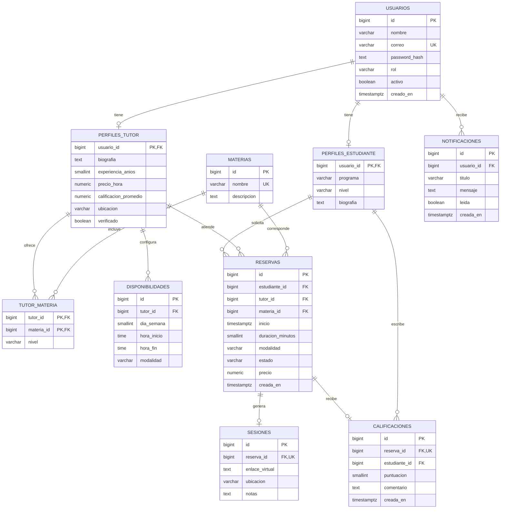

# Diagrama entidad-relación de TutoConecta

Los perfiles extienden `usuarios` y el SQL valida que el subtipo coincida con el rol. Las tutorías conectan estudiante, tutor y materia. La restricción única de `calificaciones.reserva_id` limita a una reseña por reserva; un trigger exige que califique el estudiante asociado después de completar la tutoría. Las sesiones validan enlace o ubicación según la modalidad.
