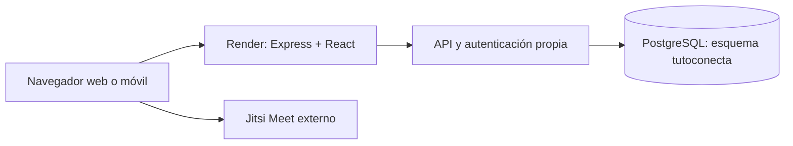

# Manual del sistema - TutoConecta

Autor: Louis Sleyth Acuña Mulford. Universidad de la Costa, Desarrollo Web, 2026.

## Arquitectura independiente

React y TypeScript presentan la interfaz adaptable. Vite genera los archivos estáticos. Express sirve esos archivos y una API JSON bajo /api en el mismo dominio HTTPS de Render. PostgreSQL conserva cuentas, perfiles, sesiones y tutorías. No se requiere ChatGPT ni se utiliza localStorage como base de datos.

## Estructura del código final

- app/client/App.tsx: navegación, formularios, filtros y llamadas a la API.
- app/client/Auth.tsx: registro, inicio de sesión y recuperación.
- app/client/style.css: presentación adaptable.
- app/server/index.ts: servidor HTTP, cabeceras, límites, salud y archivos estáticos.
- app/server/auth.ts: contraseñas, sesiones y códigos de recuperación.
- app/server/domain.ts: permisos y reglas de tutorías.
- app/server/database.ts: esquema SQL, consultas y transacciones.
- app/scripts/test-api.ts: pruebas HTTP con cuentas locales temporales.
- render.yaml: definición del servicio y referencia a PostgreSQL existente.

## Modelo relacional

Todas las tablas pertenecen al esquema tutoconecta. La conexión fija search_path=tutoconecta; no incluye public. La inicialización usa una transacción y bloqueo asesor. Las tablas se crean si no existen; no se borran tablas para iniciar o desplegar.

| Tabla | Clave y contenido | Relación |
| --- | --- | --- |
| accounts | id, email único, nombre, hashes de contraseña y recuperación | Cuenta propietaria |
| sessions | hash de token, vencimiento | N:1 accounts |
| profiles | id, nombre, rol, materia, nivel, ciudad, biografía | 1:1 accounts |
| slots | id, tutor_id, inicio, modalidad, ubicación | N:1 profiles |
| bookings | id, slot_id, student_id, inicio, estado, tema, sala | N:1 slots y profiles |
| reviews | id, booking_id único, score de 1 a 5, comentario | 0..1:1 bookings |
| notifications | id, user_id, mensaje, lectura, fecha | N:1 profiles |

Un índice único impide repetir tutor y hora. Dos índices únicos parciales de bookings impiden reservas activas simultáneas del mismo horario o estudiante/hora. Los estados considerados activos son pending, accepted y completed. Otro índice impide más de una reseña por reserva. Fechas de negocio: texto ISO UTC; presentación: America/Bogota.

## Estados y permisos

pending pasa a accepted o rejected solo por el tutor antes del inicio. pending y accepted pasan a cancelled por cualquiera de las partes antes del inicio. accepted pasa a completed solo por el tutor después de los 60 minutos. No se permite reactivar estados finales. Para reprogramar se cancela y se solicita otro horario. Las consultas de agenda solo retornan reservas del participante autenticado. La ubicación presencial exacta se revela al estudiante cuando la reserva está aceptada o finalizada.

## API

| Método | Ruta /api | Uso |
| --- | --- | --- |
| GET | health | Salud del proceso y SELECT 1 en PostgreSQL |
| GET | me | Identidad de sesión y perfil |
| GET | tutors | Catálogo y horarios públicos |
| POST | auth/register, auth/login, auth/logout, auth/reset | Registro, sesión y recuperación |
| POST | profile | Crear o actualizar el perfil propio |
| GET / POST | slots | Consultar horarios propios / publicar horario |
| POST | slots/delete | Eliminar horario propio sin historial |
| GET / POST | bookings | Consultar reservas propias / solicitar |
| POST | bookings/status | Aceptar, rechazar, cancelar o finalizar |
| POST | reviews | Valorar una reserva propia finalizada |
| GET | notifications | Últimos 100 avisos propios |
| POST | notifications/read | Marcar avisos propios como leídos |

Las respuestas de error usan JSON con error y códigos HTTP 400, 401, 403, 404, 409, 413, 415, 429 o 500 según la causa. Una consulta pública exitosa devuelve 200; el registro devuelve 201. Las operaciones se validan en el servidor con Zod; las restricciones únicas resuelven conflictos incluso con solicitudes simultáneas.

## Autenticación y seguridad

Las contraseñas de 12 a 128 caracteres se derivan con scrypt y una sal aleatoria por cuenta. La aplicación conserva el hash, no la contraseña. Se usan tokens aleatorios de 256 bits: en la base solo queda su SHA-256. La cookie es HttpOnly, SameSite=Lax y Secure en producción, con prefijo __Host-; vence a los siete días. Cerrar sesión invalida el token en la base.

El registro entrega un código aleatorio de recuperación una sola vez. Su hash se almacena en accounts. Recuperar requiere correo, código y contraseña nueva; consume el código, emite otro y revoca todas las sesiones anteriores. No hay recuperación por correo automatizada ni verificación del correo en esta versión académica.

Los POST exigen JSON y coincidencia exacta de Origin. El cuerpo se limita a 10 KB. Las rutas de autenticación limitan 30 solicitudes por IP cada 15 minutos. Helmet configura cabeceras y CSP. SQL parametrizado y permisos por identidad en servidor; el cliente no puede seleccionar su identidad mediante cabeceras. Los registros técnicos evitan imprimir contraseñas o consultas con datos.

La separación por esquema evita mezclar tablas por accidente; no equivale a aislamiento de credenciales ni a una base independiente. Para una operación comercial: rol SQL exclusivo, verificación de correo, servicio de recuperación, respaldos, límites distribuidos y una evaluación de seguridad adicional.

## Ejecución y despliegue

Requisitos: Node.js 22.12 o posterior, npm y PostgreSQL 18. Crear una base vacía, entrar en app, ejecutar npm ci, configurar DATABASE_URL y PORT en el entorno, ejecutar npm run build y npm start. Abrir http://127.0.0.1:5180. El archivo .env.example es una referencia y no se carga automáticamente.

Render usa rootDir app, compilación npm ci --include=dev && npm run build, arranque npm start y healthCheckPath /api/health. El proceso escucha en 0.0.0.0 y PORT. DATABASE_URL se obtiene de manchas-piloto-db por la red privada de Virginia, con autorización del propietario. No se abre el acceso externo de la base ni se guardan credenciales en GitHub.

El servicio gratuito puede dormir por inactividad. La instancia PostgreSQL compartida vence el 10 de diciembre de 2026 a las 21:07 (Colombia). Para conservar datos, exportar el esquema tutoconecta con pg_dump desde una conexión autorizada antes de vencer, o migrar a una base permanente. No se automatizó ni verificó un respaldo de producción.

## Validación y límites

TypeScript y compilación Vite completados. Las 55 comprobaciones HTTP locales verifican registro, sesiones, recuperación, origen, roles, privacidad, conflictos, estados, reseñas y avisos. Se repitieron con el esquema separado. Las cuentas de prueba son temporales y el script rechaza destinos remotos; no se usa contra producción.

Jitsi es externo y puede pedir acceso del anfitrión. WhatsApp prepara el texto para que el usuario lo envíe; calendario genera un archivo ICS. No hay pagos, correo/SMS automático, tutor instantáneo ni IA activa. La propuesta de IA y la estimación comercial están en el documento complementario.
