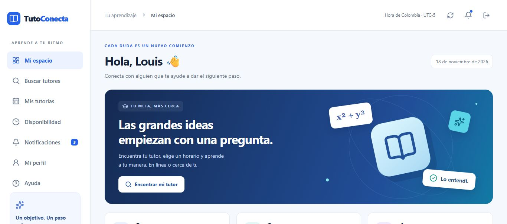
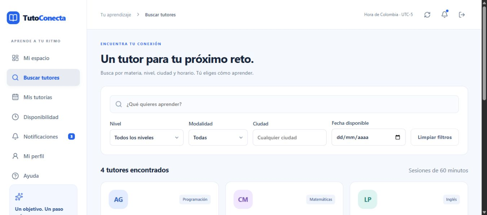
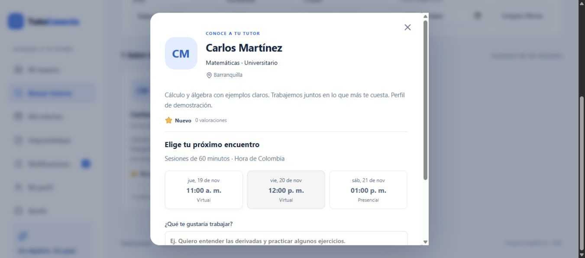

# TutoConecta - Manual de usuario y entrega

**Integrante único:** Louis Sleyth Acuña Mulford.
**Programa:** Ingeniería de Sistemas. **Asignatura:** Desarrollo Web.
**Profesor:** Morillo Vergel Edgar. **Universidad:** Universidad de la Costa, Barranquilla.
**Fecha de entrega indicada:** miércoles 18 de noviembre de 2026.

## Enlaces de entrega

Repositorio público: https://github.com/JLX1-pixel/tutoconecta
Código de frontend y backend: https://github.com/JLX1-pixel/tutoconecta/tree/main/app
Aplicación web: https://tutoconecta-louis-qfs1.onrender.com
Video de YouTube: pendiente de grabación y publicación por el estudiante.

Este documento debe completarse con el enlace real del video antes de entregarse como versión final. El guion de sustentación acompaña el proyecto y no reemplaza el video. Las tres capturas incluidas se obtuvieron de la aplicación ejecutándose en el entorno local de demostración. Ilustran las pantallas de inicio, búsqueda y reserva que se conservaron al migrar el backend a PostgreSQL. Los datos y fechas de ejemplo no representan usuarios o reservas reales del sitio público.

## 1. Qué permite hacer la aplicación

TutoConecta conecta estudiantes y tutores para coordinar sesiones de una hora, virtuales o presenciales. Un estudiante busca tutores y solicita un horario. El tutor acepta o rechaza la solicitud. Ambos consultan el estado y los detalles en Mis tutorías. Tras una sesión finalizada, el estudiante puede valorar su experiencia.

Se necesita un navegador actualizado y conexión a Internet para el sitio publicado. Para la videollamada se requiere acceso al servicio externo Jitsi y, si se van a usar, cámara y micrófono. El anfitrión puede necesitar iniciar sesión en Jitsi. La aplicación no cobra pagos.

## 2. Acceso y creación del perfil

1. Abre el enlace de la aplicación y pulsa **Iniciar sesión**.
2. Pulsa **Crear una cuenta**, escribe nombre, correo y una contraseña de al menos doce caracteres. Pulsa **Crear cuenta**. El acceso es propio de TutoConecta; no necesitas una cuenta de ChatGPT.
3. Descarga o copia el código privado de recuperación. Confirma que lo guardaste y pulsa **Continuar a mi perfil**. Solo se muestra una vez; no lo compartas.
4. En el primer acceso, completa tu nombre y selecciona **Aprender (estudiante)**, **Enseñar (tutor)** o **Aprender y enseñar**.
5. Escribe tu ciudad. Si vas a enseñar, añade materia principal, nivel educativo y una descripción de al menos diez caracteres.
6. Pulsa **Guardar perfil**. El sistema regresa a Mi espacio y adapta las opciones al rol.

En **Mi perfil** puedes modificar tus datos y rol. El correo de registro es de solo lectura en el perfil. El catálogo muestra el nombre, materia, nivel, ciudad y descripción del tutor; no muestra su correo. Si ya tienes cuenta, introduce correo y contraseña y pulsa **Entrar**. Si olvidas la contraseña, elige **Recuperar acceso**, indica correo, código de recuperación y contraseña nueva. Guarda el nuevo código; el anterior se invalida y se cierran las sesiones anteriores. Sin el código no hay recuperación automática por correo en esta versión.

El registro e inicio de sesión se procesan en el servidor. El catálogo es público; reservar, publicar horarios y gestionar tutorías requiere iniciar sesión y completar el perfil.

## 3. Mi espacio y navegación

El menú contiene Mi espacio, Buscar tutores, Mis tutorías, Notificaciones, Mi perfil y Ayuda. Si tu perfil permite enseñar, también aparece Disponibilidad. En pantallas pequeñas, abre el menú con el botón de tres líneas.

Mi espacio muestra tus tutorías por venir, sesiones finalizadas y número de tutores en la comunidad. Presenta el próximo encuentro y accesos al catálogo. El botón **Actualizar datos** vuelve a consultar el servidor; úsalo después de que otra persona acepte una solicitud. Los cambios no dependen del almacenamiento de tu navegador.

Las horas visibles están expresadas en hora de Colombia, UTC-5. El botón **Cerrar sesión** invalida tu sesión en el servidor. Sal de la sesión cuando termines en un equipo compartido.

## 4. Buscar y comparar tutores

1. Abre **Buscar tutores**.
2. Escribe el nombre de un tutor o una materia en **¿Qué quieres aprender?**.
3. Selecciona, si lo necesitas, nivel educativo, modalidad, ciudad y fecha disponible.
4. Revisa las tarjetas. Cada una muestra descripción, reputación y cantidad de horarios libres. **Nuevo** indica que aún no tiene valoraciones.
5. Pulsa **Ver perfil** para ver la presentación y los horarios.

Los filtros de modalidad y fecha muestran tutores con disponibilidad que coincide. **Limpiar filtros** restaura el catálogo. Si no hay resultados, cambia la materia o quita filtros. Si el catálogo está vacío, todavía no hay perfiles de tutor registrados en esa base de datos.

## 5. Solicitar una tutoría

1. Desde el perfil del tutor, selecciona un horario libre. Cada sesión dura 60 minutos.
2. Comprueba fecha, hora de Colombia y modalidad.
3. En **¿Qué te gustaría trabajar?**, explica tu objetivo con al menos tres caracteres. Ejemplo: “Quiero practicar reglas de derivación”.
4. Pulsa **Solicitar tutoría**.
5. Consulta la solicitud en **Mis tutorías**, con estado **Pendiente**. La confirmación depende de la aceptación del tutor.

Debes tener perfil de estudiante o ambos roles. No puedes reservar tu propio perfil. El servidor impide dos reservas activas del mismo horario y que un estudiante tenga dos sesiones activas a la misma hora. Si otra persona ocupa el horario durante el proceso, el sistema informa del conflicto; actualiza y elige otro.

## 6. Consultar, cancelar y reprogramar

En **Mis tutorías**, usa las pestañas Todas, Pendientes, Confirmadas, Finalizadas y Canceladas. Las rechazadas siguen visibles en Todas. **Ver detalle** muestra el tema, participantes, modalidad, hora y acciones disponibles.

Una reserva puede estar Pendiente, Confirmada, Rechazada, Cancelada o Finalizada. Solo las confirmadas habilitan el calendario y la sesión. Una solicitud pasada que no fue aceptada no puede aceptarse después de su inicio.

Para cancelar una solicitud pendiente o confirmada antes de su inicio, abre el detalle, pulsa **Cancelar tutoría** y revisa el mensaje. **Conservar reserva** no realiza cambios; **Confirmar cancelación** libera el horario y registra una notificación para ambas partes.

Para reprogramar, cancela la reserva futura y solicita otro horario. La nueva solicitud requiere aceptación. No se cambia automáticamente la fecha de una reserva existente.

## 7. Configurar el perfil de tutor y publicar horarios

1. En Mi perfil, activa Tutor o Aprender y enseñar.
2. Completa materia principal, nivel, ciudad y descripción. Pulsa Guardar perfil.
3. Abre **Disponibilidad**.
4. Elige una fecha futura y una hora en punto dentro del próximo año. La duración es de una hora.
5. Selecciona Virtual o Presencial. En modalidad presencial, indica un punto de encuentro de al menos cinco caracteres.
6. Pulsa **Publicar horario**. Aparecerá en Horarios publicados y en tu perfil público si está libre.

La ubicación exacta se muestra al estudiante solo cuando se confirma la reserva. El tutor puede eliminar un horario sin historial de reservas. Los horarios con reservas previas se conservan para mantener ese historial. El sistema rechaza horarios duplicados para el mismo tutor.

## 8. Gestionar solicitudes y finalizar sesiones

1. Abre Mis tutorías y filtra Pendientes.
2. Selecciona Ver detalle para revisar estudiante, objetivo y horario.
3. Antes de la hora de inicio, pulsa **Aceptar solicitud** o **Rechazar**.
4. Una aceptación cambia el estado a Confirmada y notifica a ambas partes. Un rechazo libera el horario.
5. Tras una sesión aceptada, cuando ya transcurrieron sus 60 minutos, el tutor puede pulsar **Marcar como finalizada**.

Solo el tutor propietario puede aceptar, rechazar o finalizar esa sesión. El estudiante no puede aceptar su propia solicitud. La finalización habilita la valoración del estudiante.

## 9. Sesión virtual, presencial y calendario

En una reserva virtual confirmada, pulsa **Abrir sala virtual**. El detalle carga Jitsi Meet y ofrece **Abrir Jitsi Meet** como alternativa en otra pestaña. El anfitrión puede necesitar iniciar sesión en ese servicio y autorizar cámara o micrófono. Si aparece espera de moderador, el anfitrión debe entrar primero a la misma sala.

En modalidad presencial, el detalle confirmado muestra el punto de encuentro definido por el tutor. Verifica la fecha, hora y lugar antes de asistir.

**Guardar en calendario** descarga un archivo `.ics` con inicio, fin y ubicación o enlace virtual. Ábrelo con tu aplicación de calendario para importarlo. **Compartir por WhatsApp** prepara un resumen; tú eliges destinatario y confirmas el envío. TutoConecta no envía mensajes automáticamente.

## 10. Valorar, revisar avisos y obtener ayuda

Para valorar, abre una tutoría Finalizada como estudiante y pulsa **Valorar tutoría**. Selecciona de una a cinco estrellas, añade un comentario opcional y pulsa **Enviar valoración**. Solo se permite una reseña por sesión. El promedio de las reseñas se refleja en el catálogo.

En **Notificaciones** aparecen las novedades de solicitudes y cambios de estado. El contador indica avisos sin leer. Pulsa **Marcar como leídas** para actualizar todos tus avisos. Se muestran las últimas cien notificaciones. No hay correo, SMS ni WhatsApp automático en esta versión.

**Ayuda** explica reservas, roles, sesión virtual, cancelación, valoración y recuperación de acceso. Si una operación falla, lee el mensaje, revisa los datos y actualiza. Si la conexión se interrumpe después de enviar una solicitud, consulta Mis tutorías antes de repetirla.

## 11. Alcance y comprobaciones

La aplicación utiliza React y TypeScript, una API Node.js/Express y PostgreSQL. El código final está en `app/`. Render sirve frontend y backend desde el mismo dominio HTTPS. Las páginas HTML de la raíz y `fullstack/` se conservan como antecedentes; no son la versión desplegada.

Se completó la compilación de producción y la comprobación de tipos. La batería de integración pasó 55 comprobaciones HTTP en una base local aislada: registro, inicio y cierre de sesión, recuperación y revocación de sesiones, origen, roles, fechas, privacidad, doble reserva, cancelación, rechazo, finalización, valoración única y notificaciones. Se repitió después de configurar el esquema separado de PostgreSQL.

No se afirma una prueba audiovisual entre dos personas sin realizarla. La IA generativa está descrita como propuesta de preparación y seguimiento del aprendizaje, no como servicio activo. La reserva instantánea, los pagos y los avisos externos automáticos no están implementados.

## 12. Sustentación en YouTube

Graba un recorrido de ocho a diez minutos: presentación, acceso y perfil, búsqueda y reserva, aceptación como tutor, detalle y sesión, finalización y valoración, revisión breve del frontend/API/esquema y cierre con los enlaces. Usa datos de prueba y explica con tus palabras las decisiones del código.

El archivo `Guion_Sustentacion_TutoConecta.md` proporciona una secuencia orientativa. Después de publicar el video, comprueba su enlace desde otra sesión y añádelo a este documento. No se debe entregar el PDF como completo mientras falte el enlace.

## 13. Disponibilidad del alojamiento

El servicio gratuito puede tardar aproximadamente un minuto en despertar tras inactividad. Espera y vuelve a cargar antes de concluir que falla. La base compartida de Render vence el **10 de diciembre de 2026, 21:07 (Colombia)**. Para conservar el servicio, el propietario debe exportar o migrar el esquema antes del vencimiento, o contratar un plan apropiado.

Las tablas de TutoConecta están en el esquema `tutoconecta`, separado de las tablas del otro proyecto del propietario. Se comparte capacidad y disponibilidad de la instancia. No hay cuentas de demostración públicas preconfiguradas: registra dos cuentas propias para practicar los roles.
