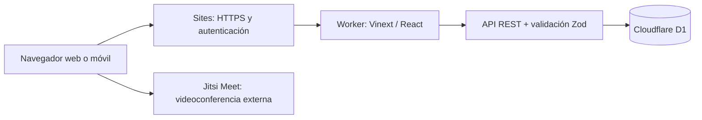
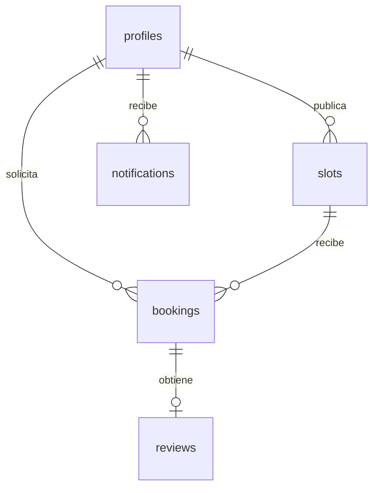

# Manual del sistema - TutoConecta

Autor: Louis Sleyth Acuña Mulford. Universidad de la Costa, Desarrollo Web, 2026.

## Arquitectura

React y TypeScript presentan la interfaz adaptable. Vinext compila las rutas a un Worker de Cloudflare. La API HTTP del mismo origen valida solicitudes con Zod y consulta D1 mediante sentencias parametrizadas. Drizzle mantiene el esquema y las migraciones versionadas. Los datos de negocio no dependen de localStorage.

El alojamiento Sites autentica visitantes y entrega cabeceras de identidad confiables al Worker. `app/chatgpt-auth.ts` obtiene esa identidad; cada operación comprueba el propietario y el rol en el servidor. Las cabeceras no deben aceptarse directamente desde Internet en un despliegue independiente: es imprescindible un gateway que las elimine y las regenere después de autenticar. El simulador local de identidad está excluido de las compilaciones de producción.

## Estructura

- `app/ui.tsx`: vistas, formularios, filtros y consumo de la API.
- `app/globals.css`: diseño adaptable, estados y accesibilidad visual.
- `app/api/[...path]/route.ts`: endpoints, autorización y reglas de reserva.
- `app/chatgpt-auth.ts`: identidad del proveedor de alojamiento.
- `db/schema.ts`: tablas, claves y restricciones.
- `drizzle/`: migraciones SQL y metadatos del esquema.
- `worker/index.ts`: punto de entrada del servidor.
- `scripts/test-api.mjs`: pruebas de integración contra el Worker local.
- `.openai/hosting.json`: identidad de despliegue y binding `DB`; no contiene contraseñas.

## Modelo de datos

Un perfil admite rol de estudiante, tutor o ambos. Cada horario tiene un tutor, una hora de inicio UTC, modalidad y ubicación privada. Las sesiones duran una hora y comienzan en horas exactas. Las reservas conservan el historial aunque se cancelen. Una restricción única parcial evita dos reservas activas sobre un mismo horario; otra evita que el estudiante reserve dos sesiones para la misma hora. Una reseña corresponde a una única reserva finalizada.

## Estados de reserva

- `pending`: el estudiante envió la solicitud y el horario quedó ocupado.
- `accepted`: el tutor aceptó; se habilitan calendario, resumen para WhatsApp y acceso a la sala o ubicación.
- `rejected`: el tutor rechazó antes del inicio; se libera el horario.
- `cancelled`: una de las partes canceló antes del inicio; se libera el horario.
- `completed`: el tutor finalizó una sesión aceptada una vez transcurridos sus 60 minutos; el estudiante puede valorar.

Reprogramar consiste en cancelar una reserva futura y solicitar otra. No hay cobros, reembolsos ni aceptación automática. Una solicitud pendiente que ya empezó no admite aceptación; se conserva en el historial. El tutor debe gestionar las solicitudes antes de su hora.

## API

| Método | Ruta | Permiso y resultado |
| --- | --- | --- |
| GET | `/api/me` | Identidad actual y perfil propio; anónimo obtiene identidad nula. |
| GET | `/api/tutors` | Catálogo sin correos y horarios futuros libres sin ubicaciones exactas. |
| POST | `/api/profile` | Usuario autenticado; crea o actualiza su propio perfil. |
| GET / POST | `/api/slots` | Horarios propios / publicación por tutor. |
| POST | `/api/slots/delete` | Tutor propietario; solo horarios sin historial de reservas. |
| GET / POST | `/api/bookings` | Reservas propias / nueva solicitud como estudiante. |
| POST | `/api/bookings/status` | Transición autorizada según propietario, estado y fecha. |
| POST | `/api/reviews` | Estudiante propietario de sesión finalizada; puntuación 1 a 5. |
| GET | `/api/notifications` | Últimas 100 notificaciones del usuario. |
| POST | `/api/notifications/read` | Marca las notificaciones propias como leídas. |

Las escrituras requieren JSON y `Origin` del mismo sitio. Se validan longitudes, tipos, UUID, roles, fechas y modalidad. Respuestas principales: 400 datos inválidos; 401 falta de sesión; 403 falta de permiso; 404 ruta o reserva inexistente; 409 conflicto; 500 error interno. Las respuestas usan `Cache-Control: no-store`.

## Operación y despliegue

Requiere Node.js >=22.13 y npm. Ejecutar `npm run install:ci`, `npm run db:generate` solo si cambia el esquema, `npm run build` y aplicar la migración local con Wrangler antes de la primera ejecución. Ver los comandos del README.

El deploy de Sites aplica las migraciones a su base D1 separada de la base local. El catálogo de producción comienza vacío: los tutores deben registrarse y publicar sus propios horarios. Los datos de prueba no se publican. Las variables de entorno secretas se configuran en el proveedor, nunca en Git.

El prototipo HTML anterior se conserva en el repositorio como antecedente. La aplicación completa se encuentra en `fullstack/`. GitHub Pages solo sirve el prototipo estático; no ejecuta el backend de esta versión.

## Integraciones y límites comprobables

Jitsi Meet se abre dentro de un iframe y también mediante un enlace alternativo. El anfitrión puede necesitar una cuenta del proveedor. La disponibilidad, los permisos multimedia y las políticas de Jitsi son externos a TutoConecta. No se afirma haber probado una llamada entre dos personas sin realizarla.

Las notificaciones internas se guardan en D1. Descargar `.ics` permite añadir una sesión al calendario del usuario. Compartir por WhatsApp abre un resumen y requiere que el usuario elija destinatario y envíe el mensaje. No hay envío automático de correo, SMS o WhatsApp en esta versión.

La IA generativa se documenta como propuesta en `PROPUESTA.md`; no se simula una respuesta de IA ni se requiere una clave para los flujos implementados. El sistema no incluye pagos, verificación de títulos profesionales ni reservas instantáneas.

Fuentes técnicas: [documentación de Jitsi para iniciar reuniones](https://jitsi.github.io/handbook/docs/user-guide/user-guide-start-a-jitsi-meeting/) y [API de integración](https://jitsi.github.io/handbook/docs/dev-guide/dev-guide-iframe/).
